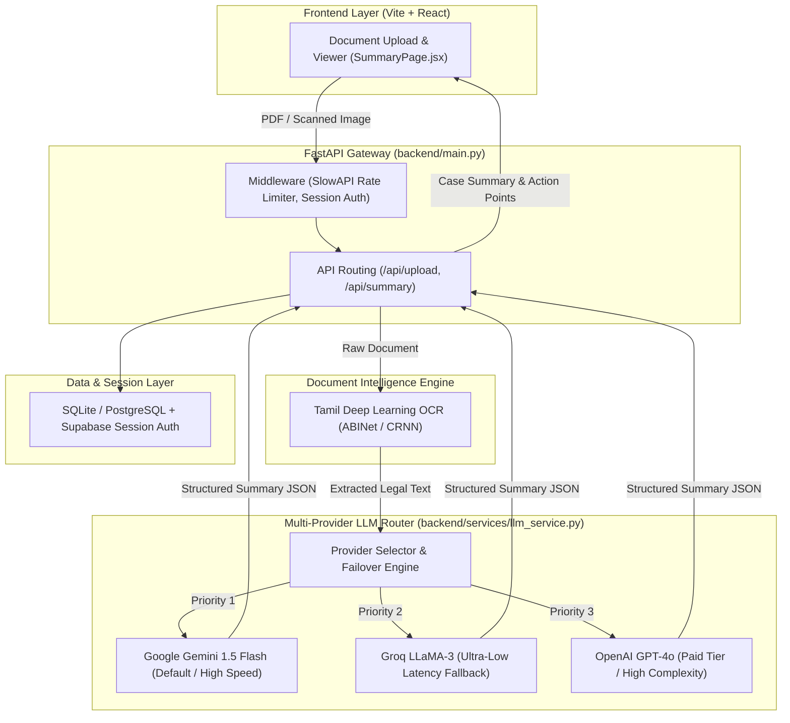

# Tamil Legal Document Summarizer & Intelligent OCR Pipeline

An end-to-end multi-tier AI platform for legal document digitization and natural language summarization. This system processes complex, scanned regional language legal documents (Tamil), performs deep learning OCR text extraction, and feeds normalized legal text through a cost-optimized, multi-provider LLM router (Google Gemini, Groq, OpenAI) to generate structured case summaries, key dates, party obligations, and risk factors.

---

## 📌 Problem Statement

Legal documents in regional languages like Tamil often exist only as legacy physical scans or low-resolution PDFs. Legal practitioners and clients face high barrier-to-entry costs and manual cognitive overhead parsing hundreds of pages of legalese. 

**Tamil Legal Summarizer** bridges this gap by:
1. Extracting high-accuracy Tamil text from noisy document scans using an integrated ABINet / CRNN deep learning OCR model.
2. Routing extracted text dynamically through cost-effective LLM backends with automated failover (Gemini Flash $\to$ Groq LLaMA $\to$ OpenAI).
3. Producing bilingual, deterministic summaries highlighting critical clauses, case citations, party obligations, and timeline analysis.

---

## 🏛️ System Architecture



---

## 🌟 Key Engineering Features

- **Multi-Provider LLM Router with Cost Optimization:**
  - `LLMService` in [`backend/services/llm_service.py`](backend/services/llm_service.py) automatically detects configured API keys (`GOOGLE_API_KEY`, `GROQ_API_KEY`, `OPENAI_API_KEY`) and defaults to high-throughput, free/low-cost models (Gemini Flash / Groq) before escalating to paid providers.
- **Deep Learning Tamil OCR Subsystem:**
  - Packaged OCR engine utilizing ABINet/CRNN architectures for robust character recognition of Tamil typography.
- **Resilient API Architecture:**
  - Built on **FastAPI** with `slowapi` rate limiting, trusted host protection, asynchronous request lifecycles, and CORS security.
- **Scheduled Background Cleanup:**
  - Background scheduler (`cron_jobs.py`) that periodically cleans temporary upload artifacts to avoid disk leaks.

---

## 📡 API Endpoints

| Method | Endpoint | Description |
|---|---|---|
| `POST` | `/api/upload` | Uploads scanned legal document (PDF, PNG, JPG) for OCR processing |
| `POST` | `/api/summary/generate` | Triggers multi-provider LLM generation for legal breakdown |
| `GET` | `/api/summary/{id}` | Fetches cached summary breakdown (overview, parties, risks, timeline) |
| `POST` | `/routes/auth/*` | Session management and authentication |
| `GET` | `/health` | System diagnostics & OCR worker health check |

---

## 🚀 Setup & Installation

### 1. Prerequisites
- Python 3.10+
- Node.js 18+ (for frontend)
- Tesseract / PyTorch dependencies for OCR

### 2. Backend Setup
```bash
# Clone the repository
git clone https://github.com/shyamdeepan18/Tamil_legal-summary.git
cd Tamil_legal-summary/backend

# Virtual environment setup
python3 -m venv venv
source venv/bin/activate

# Install requirements
pip install -r requirements.txt

# Configure environment
cp .env.example .env
```

Configure your `.env` file:
```env
GOOGLE_API_KEY="your-gemini-api-key"
GROQ_API_KEY="your-groq-api-key"        # Optional fallback
OPENAI_API_KEY="your-openai-api-key"    # Optional fallback
SUPABASE_URL="your-supabase-url"
SUPABASE_SERVICE_ROLE_KEY="your-service-role-key"
SECRET_KEY="your-jwt-secret-key"
```

Start the FastAPI backend:
```bash
uvicorn main:app --reload --port 8000
```

### 3. Frontend Setup
```bash
cd ../frontend
npm install
npm run dev
```
Access the application at `http://localhost:3000`.

---

## 📜 License
MIT License. Built for legal accessibility and AI research.
