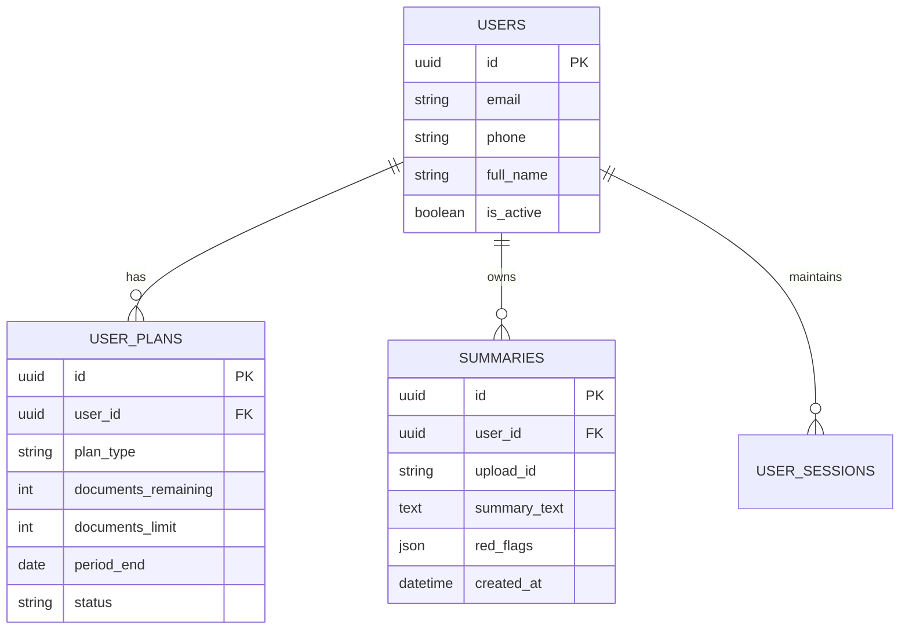

# Project Architecture: Tamil Legal Document Summarizer

## 1. Executive Summary
**Project Name**: Tamil Legal Document Summarizer (Tamil OCR)
**Goal**: A privacy-focused MVP that allows users to upload Tamil legal documents (PDFs), performs OCR/Classification, and generates simplified summaries in Tamil/English using LLMs. The system enables a "try before you buy" flow with previews and tier-based subscription models.

---

## 2. High-Level Architecture

The system follows a **Modern Serverless Architecture** designed for scalability and low maintenance. It separates the client (Frontend) from the business logic (Backend API), connected via RESTful endpoints.

### System Diagram

```mermaid
graph TD
    User[End User]
    
    subgraph Client [Frontend (Vercel Edge)]
        Web[React SPA (Vite)]
        Assets[Static Assets]
    end
    
    subgraph Server [Backend (Vercel Serverless)]
        API[FastAPI Gateway]
        AuthService[Auth Service]
        UploadService[Upload & Validation]
        OCRService[OCR Engine]
        PayService[Payment Processor]
    end
    
    subgraph Infrastructure [External Services & Data]
        DB[(Supabase PostgreSQL)]
        LLM[Google Gemini / Groq]
        Payment[Razorpay Gateway]
    end

    User -->|HTTPS| Web
    Web -->|JSON/Multipart| API
    
    API --> AuthService
    API --> UploadService
    API --> PayService
    
    AuthService --> DB
    PayService --> Payment
    PayService --> DB
    
    UploadService -->|1. Temp Store| LocalStorage(Ephemeral /tmp)
    UploadService -->|2. Extract Text| OCRService
    OCRService -->|3. Generate Summary| LLM
```

---

## 3. Technology Stack

| Component | Technology | Rationale |
|-----------|------------|-----------|
| **Frontend** | React 18 (Vite) | Fast processing, component-based UI, excellent ecosystem. |
| **Styling** | Tailwind CSS | Rapid UI development, responsive design, small bundle size. |
| **Backend** | Python FastAPI | High performance (async), easy integration with AI/OCR libs. |
| **Database** | PostgreSQL (Supabase) | Relational integrity, scalable, built-in vector support (future-proof). |
| **ORM** | SQLAlchemy | Robust SQL abstraction for Python. |
| **AI/LLM** | Google Gemini Flash | Cost-effective (Free tier), large context window for legal docs. |
| **OCR** | Tesseract / PyPDF2 | Open-source extraction for Tamil text and PDF parsing. |
| **Payment** | Razorpay | India-specific optimization, reliable webhook support. |
| **Hosting** | Vercel | Seamless deployment for both frontend and Python serverless functions. |

---

## 4. Key Modules & Data Flow

### A. Authentication & User Management
*   **Model**: Session-based authentication with Bearer tokens.
*   **Features**: Signup/Login (Email/Phone), OTP verification, Profile management.
*   **Plans**: Tiered access (`free`, `quick_check`, `monthly_pack`, `pro_monthly`) with logic for rollover documents and expiry.

### B. Document Processing Pipeline
1.  **Upload**: User uploads PDF → Backend validates (Size, FileType, Plan Limits).
2.  **Security**: Checks for password protection and corruption.
3.  **Storage**: Currently uses **Ephemeral Storage** (`/tmp`) for immediate processing.
4.  **OCR & Classification**:
    *   Detects Language (Tamil/English).
    *   Extracts Text (OCR).
    *   Classifies type (Sale Deed, Rental Agreement, etc.).
5.  **Preview**: Generates a "Safe Preview" (blurred or partial) to show the user data was extracted successfully before payment/deduction.

### C. Payment Flow
1.  **Initiation**: User selects plan/action → Backend creates Razorpay Order.
2.  **Transaction**: Frontend invokes Razorpay Checkout → User pays.
3.  **Verification**: 
    *   Sync: Immediate signature verification on success.
    *   Async: Webhook listener `payment.captured` for redundancy.
4.  **Fulfillment**: Updates `UserPlan` table (activates plan, adds document credits).

---

## 5. Database Schema (Entity Relationship)



---

## 6. Key Notes for Stakeholders

### 👷‍♂️ For the System Architect

1.  **Serverless Constraints**: 
    *   The Vercel Serverless environment has a **timeout limit** (usually 10s-60s on free/pro tiers).
    *   **Risk**: OCR and LLM generation for large PDFs might exceed this timeout.
    *   **Recommendation**: Move long-running OCR tasks to background workers (Celery/Redis Queue) or use Vercel Background Functions if manageable, potentially splitting the "Upload" and "Process" steps.
    
2.  **Ephemeral Storage**:
    *   The current `upload.py` saves files to `/tmp`. In a serverless environment, this file disappears after the function finishes.
    *   **Implication**: We cannot "retry" a failed processing job later without re-upload.
    *   **Recommendation**: Integrate **Supabase Storage (S3)** to persist the raw PDF immediately upon upload.

3.  **Scalability**:
    *   Database connection pooling is handled via Supabase (pgbouncer), which is excellent.
    *   LLM Rate Limits: Google Gemini Free tier has limits (15 RPM). We need a fallback queue or round-robin strategy if traffic spikes.

### 🎨 For the Product Designer

1.  **User Experience (UX)**:
    *   **Upload Anxiety**: Users are uploading sensitive legal docs. The UI must emphasize "Encryption" and "Privacy" visually.
    *   **Monetization**: The flow is `Upload -> Validate -> Preview -> Pay/Deduct`. The "Preview" screen is the most critical conversion driver. It must show partial success (e.g., "We found 15 key clauses") to encourage payment.
    
2.  **Language Support**:
    *   The app targets Tamil speakers. All error messages (validations, payment failures) are already localized in the backend (`tamil_message`). The UI must switch languages seamlessly.

3.  **Mobile First**:
    *   The primary use case is likely a user taking a photo/scan of a document on their phone. The "Scan" or "Upload" button should be the primary CTA.
